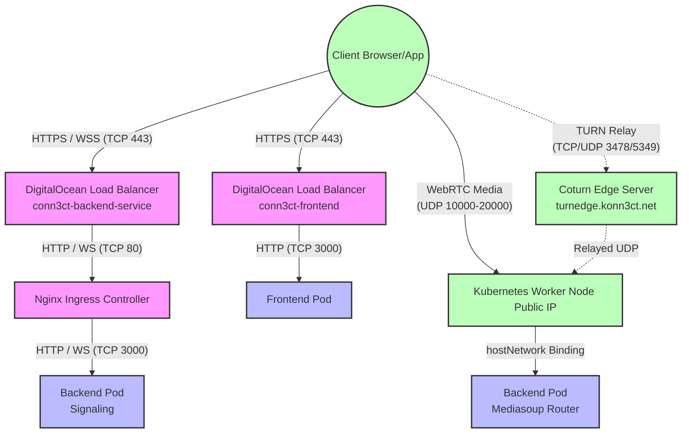

# Konn3ct Network and Infrastructure Configuration (Detailed)

This document outlines the network architecture, required load balancers, firewall configurations, and detailed traffic flows for the Konn3ct platform. This is designed for Network Engineers, DevOps, and SREs to fully understand the networking requirements, specifically focusing on the WebRTC media (UDP) aspects.

---

## 1. High-Level Traffic Flow Architecture

The Konn3ct platform separates **Signaling Traffic (TCP/WebSockets)** from **Media Traffic (UDP/WebRTC)** at the network level to ensure low latency and high throughput for video and audio.

---

## 2. WebRTC & Media Routing Details (Mediasoup)

WebRTC media routing is the most critical networking component. Konn3ct uses **Mediasoup**, which runs as a C++ worker process inside the `conn3ct-backend` pods. 

### Host Network Optimization
- **`hostNetwork: true`**: The `conn3ct-backend` deployment runs on the Kubernetes host network. 
- **Why?** This allows Mediasoup to bind directly to the Node's network interfaces. It bypasses the Kubernetes CNI (like Flannel or Calico) and `kube-proxy` NAT. This reduces CPU overhead, eliminates NAT translation delays, and allows the Mediasoup worker to directly report the Node's external IP to connecting clients via SDP offers.

### IP and Port Assignments
- **Listen IP (`WEBRTC_LISTEN_IP`)**: `0.0.0.0` (Binds to all interfaces on the node).
- **Announced IP (`WEBRTC_ANNOUNCED_IP`)**: Injected via `status.hostIP` via the Kubernetes Downward API. This MUST be the public IP of the worker node so that clients over the internet can route UDP packets back to it.
- **Port Range**: `10000 - 20000` (UDP). Each new video/audio track dynamically allocates a port from this range.

### STUN / TURN Fallback
For clients behind strict corporate firewalls or symmetric NATs that block outbound UDP, Konn3ct uses an external TURN server:
- **TURN Domain**: `turnedge.konn3ct.net`
- If direct UDP to the worker node fails, the client browser will automatically establish a connection to the TURN server, which will relay traffic to the worker node's UDP ports.

> [!WARNING]
> **Scaling Constraint (Port Conflicts):** Because `hostNetwork: true` is enabled, the backend pod binds its HTTP server directly to TCP `3000` on the worker node. Therefore, **only one `conn3ct-backend` pod can run per Kubernetes Worker Node**. The autoscaler (`maxReplicas: 20`) implies you need at least 20 worker nodes in the cluster to reach maximum capacity, or you must implement an anti-affinity rule to prevent scheduling collisions.

---

## 3. Kubernetes Services & Ingress

### Ingress Controller (`conn3ct-ingress`)
- **Sticky Sessions:** Uses `nginx.ingress.kubernetes.io/upstream-hash-by: "$arg_roomId"`. 
  - **Criticality:** When a user connects to `?roomId=xyz`, the WebSocket signaling connection MUST go to the pod that is hosting that room's Mediasoup router. If it goes to a different pod, the media session will fail.
- **Timeouts:** `proxy-read-timeout` and `proxy-send-timeout` are set to `3600` (1 hour) to ensure WebSockets remain alive during long, inactive meetings.

### Load Balancers (L4/L7)
1. **Frontend Load Balancer (`conn3ct-frontend`)**
   - Exposes standard HTTP/HTTPS routing to the Next.js frontend pods.
2. **Backend Service (`conn3ct-backend-service`)**
   - A generic LoadBalancer pointing to the Nginx Ingress. The Ingress handles the TLS termination (if configured) and WebSocket upgrades (`/signal`).

---

## 4. Comprehensive Firewall (Security Group) Requirements

These rules must be applied at the infrastructure level (e.g., AWS Security Groups, DigitalOcean Cloud Firewalls) attached to the **Kubernetes Worker Nodes**.

### Inbound Rules (Ingress to Nodes)

| Protocol | Port Range    | Source (CIDR) | Purpose |
|----------|---------------|---------------|---------|
| TCP      | 80            | 0.0.0.0/0     | HTTP traffic to NodePorts/LoadBalancers |
| TCP      | 443           | 0.0.0.0/0     | HTTPS traffic to NodePorts/LoadBalancers |
| **UDP**  | **10000 - 20000** | **0.0.0.0/0** | **CRITICAL: Direct WebRTC Media Traffic. Dropping these packets results in black screens or no audio.** |
| TCP      | 3000          | VPC / Subnet  | Internal LB health checks and Ingress routing to the `hostNetwork` pods. |
| TCP/UDP  | *Varies by CNI* | VPC / Subnet  | Kubernetes overlay network (e.g., VXLAN/Calico) for pod-to-pod communication. |

### Outbound Rules (Egress from Nodes)

| Protocol | Port Range | Destination | Purpose |
|----------|------------|-------------|---------|
| All      | All        | 0.0.0.0/0   | Default Outbound. Required for the backend to communicate with APIs: Gemini, OpenAI, Deepgram, Paystack, and DigitalOcean Spaces. |

---

## 5. Summary Checklist for Network Engineers

1. [ ] **Verify Worker Node Public IPs:** Ensure that `status.hostIP` accurately reflects the Public, routable IP of the node. If nodes are in a private subnet behind a NAT gateway, `WEBRTC_ANNOUNCED_IP` must be set to the NAT Gateway's public IP, and port forwarding (10000-20000 UDP) must be configured from the NAT to the specific nodes (which is extremely complex). **Publicly routable worker nodes are highly recommended.**
2. [ ] **Verify UDP Port Range:** Ensure the cloud firewall allows `10000-20000 UDP` directly to the worker nodes, *not* just to the Load Balancers.
3. [ ] **Load Balancer WebSockets:** Ensure your Load Balancer timeouts are long enough to support long-lived WebSocket connections, and that WebSocket upgrade headers are passed through.
4. [ ] **TURN Connectivity:** Verify that the backend can reach `turnedge.konn3ct.net` to issue credentials, and that clients can reach it over standard TURN ports (TCP 443 / UDP 3478).
